<!-- markdownlint-disable MD013 MD033 MD041 -->
<div align="center">

### My Home Operations Repository ☸

_... managed with [Flux](https://fluxcd.io/), [Renovate](https://github.com/renovatebot/renovate) and [Forgejo Actions](https://forgejo.org/docs/latest/user/actions/)_ 🤖

</div>
<!-- markdownlint-enable MD033 MD041 -->

---

##  Overview

This is a mono repository for my home infrastructure and Kubernetes cluster. I try to stick to Infrastructure as Code
(IaC) and GitOps practices, using tools like [Talos](https://www.talos.dev/), [Kubernetes](https://kubernetes.io/),
[Flux](https://github.com/fluxcd/flux2), [Renovate](https://github.com/renovatebot/renovate)
and [Forgejo Actions](https://forgejo.org/docs/latest/user/actions/).

The source of truth lives on my self-hosted [Forgejo](https://forgejo.org/) and is push-mirrored to
[GitHub](https://github.com/yukariin/cluster).

---

##  Kubernetes

My Kubernetes cluster runs [Talos](https://www.talos.dev) on three small Meteor Lake boxes, all of them control-plane
nodes that also run workloads. It's a hyper-converged setup: workloads and block storage share the same nodes, and a
separate NAS handles NFS media shares, S3 object storage and backups.

If you want to follow along with some of the practices I use here, onedr0p's
[cluster-template](https://github.com/onedr0p/cluster-template) is a great place to start.

### Core Components

- **Networking**: [cilium](https://github.com/cilium/cilium) provides eBPF-based networking and advertises
  LoadBalancer IPs to the router over BGP. [envoy-gateway](https://github.com/envoyproxy/gateway) implements the Gateway API
  with separate `internal` and `external` gateways. [towonel](https://codeberg.org/towonel) carries public ingress from a
  VPS edge back home with end-to-end TLS. [multus](https://github.com/k8snetworkplumbingwg/multus-cni) attaches pods
  that need it to the IoT VLAN.
- **Security & Secrets**: [cert-manager](https://github.com/cert-manager/cert-manager) issues Let's Encrypt certificates
  over DNS-01, and [trust-manager](https://github.com/cert-manager/trust-manager) distributes internal CAs.
  [external-secrets](https://github.com/external-secrets/external-secrets) pulls secrets from a self-hosted
  [Vault](https://www.vaultproject.io/). [Pocket ID](https://github.com/pocket-id/pocket-id) is the passkey-based
  OIDC provider for SSO.
- **Storage & Data Protection**: [rook](https://github.com/rook/rook) runs Ceph across the nodes' NVMe drives for
  persistent volumes. [kopiur](https://github.com/home-operations/kopiur) backs up and restores PVCs to the NAS.
  [CloudNativePG](https://github.com/cloudnative-pg/cloudnative-pg) runs one shared Postgres cluster, archiving WAL
  and base backups to S3 on the NAS. [spegel](https://github.com/spegel-org/spegel) runs a stateless,
  cluster-local OCI image mirror.
- **Observability**: [VictoriaMetrics](https://github.com/VictoriaMetrics/VictoriaMetrics) and
  [VictoriaLogs](https://docs.victoriametrics.com/victorialogs/) handle metrics, alerting and logs, with
  [fluent-bit](https://github.com/fluent/fluent-bit) shipping logs, [Grafana](https://github.com/grafana/grafana) for
  dashboards and [gatus](https://github.com/TwiN/gatus) for status checks generated from HTTPRoutes.
- **Automation**: [renovate-operator](https://github.com/mogenius/renovate-operator) runs Renovate in-cluster against
  Forgejo. [tuppr](https://github.com/home-operations/tuppr) handles Talos and Kubernetes upgrades.
  [forgejo-runner](https://code.forgejo.org/forgejo/runner) runs CI jobs, including
  [flate](https://github.com/home-operations/flate) render diffs on pull requests.

### GitOps

[Flux](https://github.com/fluxcd/flux2) watches the [kubernetes](./kubernetes/) folder (see Directories below) and
makes changes to my cluster based on the state of this Git repository.

Flux, deployed through [flux-operator](https://github.com/controlplaneio-fluxcd/flux-operator), recursively searches
the `kubernetes/apps` folder until it finds the top-level `kustomization.yaml` in each directory, then applies all the
resources listed in it. That `kustomization.yaml` usually holds just a namespace and one or more Flux kustomizations
(`ks.yaml`). Those Flux kustomizations control a `HelmRelease` or other resources for the application. Shared
building blocks (Postgres roles, Dragonfly, kopiur backups, OIDC clients, GPU access, alerts) are pulled in as
reusable [kustomize components](./kubernetes/components/).

[Renovate](https://github.com/renovatebot/renovate) watches my **entire** repository for dependency updates and opens
a PR when it finds one. Some PRs merge automatically, others wait for me, and Flux applies the changes once they're merged.

### Docker

Things that can't (or shouldn't) live inside the cluster run on the NAS as [Docker Compose](https://compose-spec.io/)
stacks in the [docker](./docker/) folder. That includes Vault, [Garage](https://garagehq.deuxfleurs.fr/) S3,
[matchbox](https://github.com/poseidon/matchbox) and TFTP for PXE booting Talos, Traefik, and exporters.

### Directories

This Git repository contains the following directories.

```sh
📁 bootstrap      # helmfile + resources to kickstart the cluster from bare Talos
📁 docker         # compose stacks for the NAS
📁 docs           # migration notes and incident write-ups
📁 kubernetes
├── 📁 apps       # applications, grouped by namespace
├── 📁 components # reusable kustomize components
└── 📁 flux       # flux entrypoint and shared repositories
📁 talos          # talos machine config + per-node patches (minijinja templates)
```

Day-to-day tasks are wrapped in [just](https://github.com/casey/just) recipes (`just -l`), and tooling is pinned with
[mise](https://mise.jdx.dev/).

---

##  Cloud Dependencies

Most of my infrastructure and workloads are self-hosted, but I rely on the cloud for a few key pieces: public ingress
without exposing my home IP, DNS, and outgoing mail.

| Service                                    | Use                                                       | Cost            |
|--------------------------------------------|-----------------------------------------------------------|-----------------|
| [Cloudflare](https://www.cloudflare.com/)  | Domain registrar and DNS                                  | $17/yr          |
| [GitHub](https://github.com/)              | Public mirror of this repository                          | Free            |
| [SMTP2GO](https://www.smtp2go.com/)        | Outgoing email relay                                      | Free            |
| VPS                                        | Public ingress edge ([towonel](https://codeberg.org/towonel) hub) | $5/mo   |
|                                            |                                                           | Total: ~$6.5/mo |

### Networking

```mermaid
graph TD
    %% Class Definitions
    classDef wan fill:#f87171,stroke:#fff,stroke-width:2px,color:#fff,font-weight:bold;
    classDef core fill:#60a5fa,stroke:#fff,stroke-width:2px,color:#fff,font-weight:bold;
    classDef agg fill:#34d399,stroke:#fff,stroke-width:2px,color:#fff,font-weight:bold;
    classDef switch fill:#a78bfa,stroke:#fff,stroke-width:2px,color:#fff,font-weight:bold;
    classDef device fill:#facc15,stroke:#fff,stroke-width:2px,color:#000,font-weight:bold;
    classDef vlan fill:#1f2937,stroke:#fff,stroke-width:1px,color:#fff,font-size:12px;

    %% Nodes
    VPS[☁️ VPS<br/>towonel hub]:::wan
    WAN[🛜 WAN]:::wan
    UDM[📦 UDM-Pro]:::core
    AGG[🔗 USW-Aggregation]:::agg
    PMAX[🔌 USW-Pro-Max-16-PoE]:::switch
    FLEX[🔌 USW-Flex-2.5G]:::switch
    AP[📡 U7-Pro-Wall]:::switch
    NAS[💾 NAS]:::device
    KUBE[☸️ Kubernetes<br/>3 Nodes]:::device
    WIFI[📶 WiFi Clients]:::device

    %% Subgraph for VLANs
    subgraph VLANs [Networks]
        direction TB
        MGMT[Management Network<br/>192.168.10.0/24]:::vlan
        IOT[IoT Network<br/>192.168.30.0/24]:::vlan
        HOMELAB[Homelab Network<br/>192.168.90.0/24]:::vlan
        LB[BGP LoadBalancer Pool<br/>192.168.100.0/24]:::vlan
        VPN[VPN Clients<br/>192.168.3.0/24]:::vlan
    end

    style VLANs fill:#111,stroke:#fff,stroke-width:2px,rx:0,ry:0,padding:20px;

    %% Links
    VPS -.->|towonel tunnel| WAN
    WAN -.->|WAN| UDM
    UDM --> AGG
    AGG --> PMAX
    PMAX -- 1G --- NAS
    PMAX --> AP
    AP --> WIFI
    PMAX --> FLEX
    FLEX -- 3x 2.5G --- KUBE

    %% Cluster backbone
    linkStyle 8 stroke-width:4px,stroke:#34d399

    %% Move VLANs below the graph, to the middle
    KUBE -.-> HOMELAB
    linkStyle 9 stroke-width:0,opacity:0;
```

<details>
  <summary>Click to see a high-level network diagram</summary>



</details>

---

##  DNS

Two instances of [ExternalDNS](https://github.com/kubernetes-sigs/external-dns) run in the cluster. One syncs private
records to the `UDM-Pro` using the
[ExternalDNS webhook provider for UniFi](https://github.com/kashalls/external-dns-unifi-webhook). The other syncs public
records to `Cloudflare`, but only for routes attached to the `envoy-external` gateway. Those records point at the VPS
edge, which forwards traffic home through towonel.

This gives split-horizon DNS. On the LAN or over VPN, my domain resolves straight to the internal
LoadBalancer IPs. From anywhere else it resolves to the VPS, and only `external` routes are reachable.

---

##  Hardware

| Device                                           | Num | OS Disk Size | Data Disk Size        | Ram         | OS    | Function                |
|--------------------------------------------------|-----|--------------|-----------------------|-------------|-------|-------------------------|
| MSI Cubi NUC AI 1UMG (Intel Core Ultra 7 155H)   | 1   | 256GB NVMe   | 1TB NVMe (rook-ceph)  | 64GB (2x32) | Talos | Kubernetes (`sakuya`)   |
| MSI Cubi NUC AI 1UMG (Intel Core Ultra 7 155H)   | 2   | 256GB NVMe   | 1TB NVMe (rook-ceph)  | 32GB (1x32) | Talos | Kubernetes (`flandre`, `remilia`) |
| NAS                                              | 1   | 16GB NVMe    | 2x4TB ZFS (mirror)    | 32GB (2x16) | TrueNAS | NFS, S3, Vault, PXE   |
| UniFi UDM-Pro                                    | 1   | -            | -                     | -           | -     | Router, BGP peer        |
| UniFi USW-Aggregation                            | 1   | -            | -                     | -           | -     | 10Gb Aggregation Switch |
| UniFi USW-Pro-Max-16-PoE                         | 1   | -            | -                     | -           | -     | PoE Switch              |
| UniFi USW-Flex-2.5G                              | 1   | -            | -                     | -           | -     | 2.5Gb Cluster Backbone  |
| UniFi U7-Pro-Wall                                | 1   | -            | -                     | -           | -     | Wi-Fi 7 Access Point    |

---

##  Gratitude and Thanks

Thanks to all the people who donate their time to the [Home Operations](https://discord.gg/home-operations) Discord
community. Much of the inspiration for this cluster comes from people who share theirs under the
[k8s-at-home](https://github.com/topics/k8s-at-home) GitHub topic. Be sure to check out
[kubesearch.dev](https://kubesearch.dev/) for ideas on how to deploy applications or what you could deploy.
